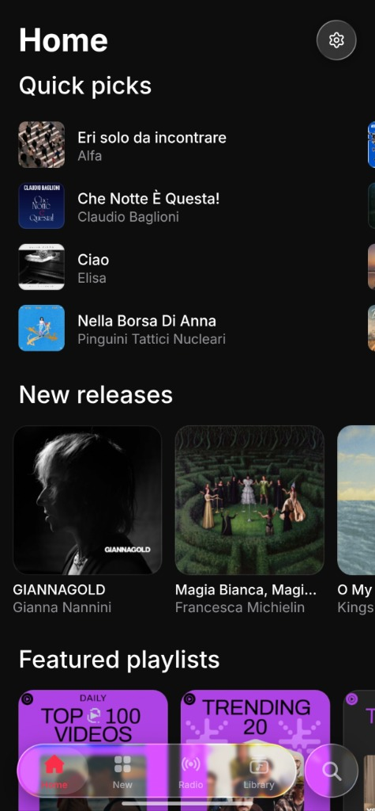
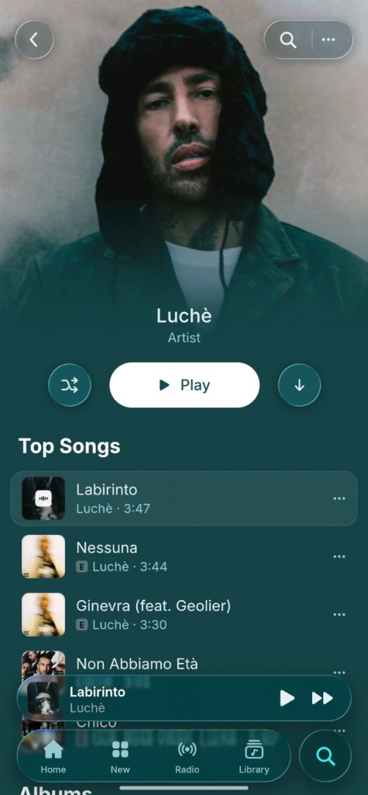

<div align="center">
  
  <h1>Sonora</h1>
  <p>A YouTube Music Android client with a WebGL Liquid Glass interface, Media3 PCM audio engine, and word-synced lyrics.</p>

  <p>
    
    
    
  </p>
</div>

---

## Features

- **Discovery & Search**: Personalized Home quick picks, new releases, charts, moods & genres, artist/album pages, and multi-category search via InnerTube.
- **Reliable Background Playback**: Native Android Media3 ExoPlayer service with lock-screen & notification controls, chunked stream fetching (`ChunkedDataSource`), and stream resolution backed by `NewPipeExtractor`.
- **Audio Engine**: Dual-player PCM crossfade, instant skip-fade (`PcmMixer`), and a built-in 5-band parametric equalizer (60Hz, 230Hz, 910Hz, 3.6kHz, 14kHz).
- **Synced & Word-by-Word Lyrics**: Automatic multi-source lyrics resolution with priority ordering (`Apple Music` / `lossless.wtf` & `Better Lyrics` TTML word-synced, `LRCLIB`, `NetEase`, `KuGou` KRC word-synced, and `Lyrics.ovh` fallback), animated karaoke view, and **Lyrics Alone** mode.
- **Liquid Glass UI**: Custom WebGL refraction shader renderer, domain-warped OKLab player backdrop animated from cover art, Light / Dark / Dynamic album themes, and skeleton shimmer loading.
- **Library & Offline**: Local playlists, favorites, downloaded tracks for offline listening, Smart Shuffle, swipe-to-queue, skip-affinity learning, and a Monthly Listening Recap.

## Screenshots

<p align="center">
  
  
</p>

## Download

Grab the latest signed APK (**`Sonora.apk`**) from the [Releases](https://github.com/xvly0/Sonora/releases/latest) page.

## Building from Source

### Requirements

- Android Studio Ladybug+ or Android SDK (Compile SDK 35, Min SDK 26)
- JDK 17

### Debug Build

```bash
git clone https://github.com/xvly0/Sonora.git
cd Sonora
./gradlew assembleDebug
```

### Signed Release Build

Create a `keystore.properties` file in the project root (ignored by Git):

```properties
storeFile=release.keystore
storePassword=your-store-password
keyAlias=sonora
keyPassword=your-key-password
```

Alternatively, provide `KEYSTORE_FILE`, `KEYSTORE_PASSWORD`, `KEY_ALIAS`, and `KEY_PASSWORD` as environment variables, then run:

```bash
./gradlew assembleRelease
```

## Disclaimer

Sonora is a free, open-source third-party client created for personal and educational use. It has no affiliation with Google LLC, YouTube, Apple Inc., or any music label or service. No copyrighted audio or media is hosted by this project; all content is streamed directly from publicly accessible third-party services.

## License

Sonora is licensed under the **GNU General Public License v3.0 (GPL-3.0)**. See the [LICENSE](LICENSE) file for the full license text.
